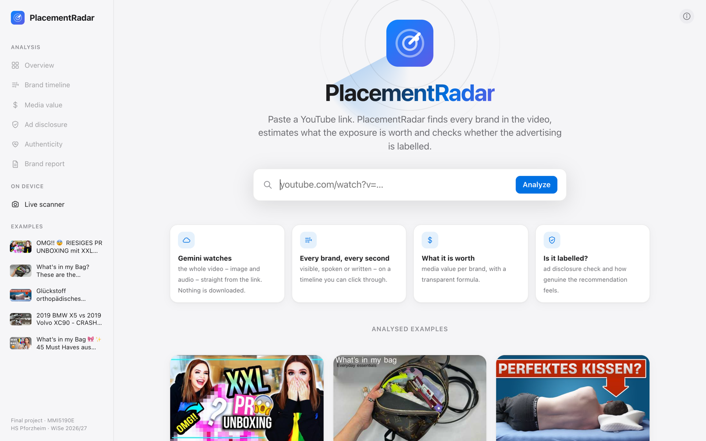
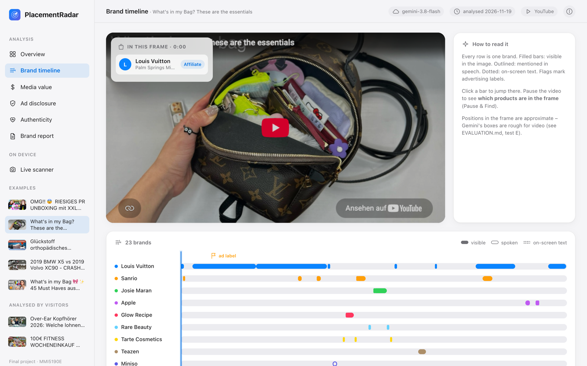
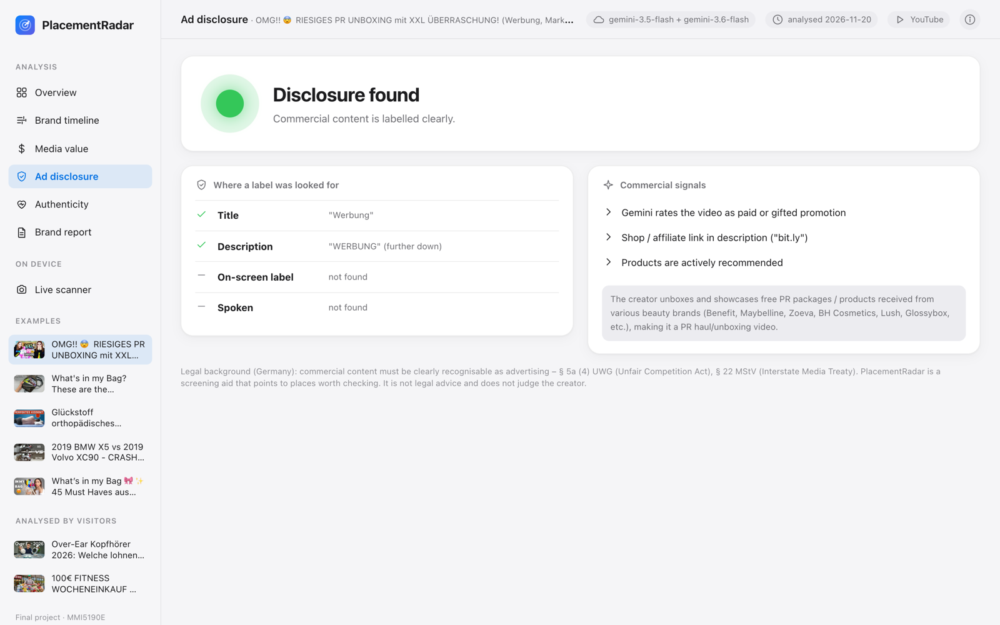
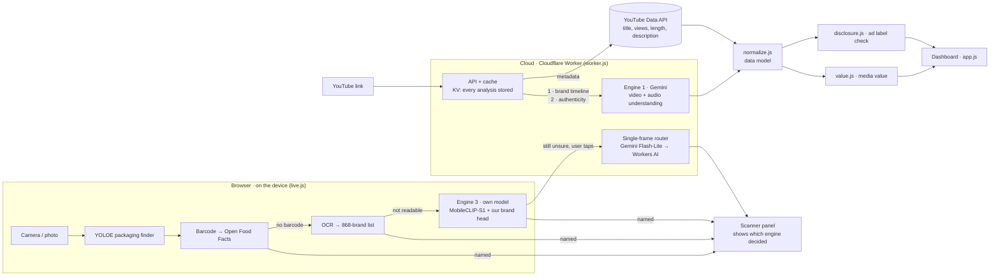

# PlacementRadar

**Paste a YouTube link – PlacementRadar finds every brand in the video, estimates what that exposure is worth, checks whether the advertising is labelled, and rates how genuine the recommendation feels. Point a camera at products and it names them on your device.**

Final project for *MMI5190E – The New Frontiers of AI: From Perception to Agentic Intelligence* (Prof. Pin Luarn), M.Sc. Marketing Intelligence, Pforzheim University, winter term 2026/27. Author: Moritz Binder.

> **Live: https://placementradar.itsmoribind.workers.dev** – no login, no key needed.
> The five example videos and the live scanner always work, even when the free Gemini quota of the day is used up.

| Document | What is in it |
|---|---|
| this README | 3-minute tour, architecture, formulas, hosting |
| [MODELS.md](MODELS.md) | every model: source, licence, size, role, measured performance |
| [EVALUATION.md](EVALUATION.md) | every test we ran – including what failed and what we changed because of it |

---

## 0. PlacementRadar in 3 minutes

**1 · Start.** Paste any public YouTube link (up to 20 min) or open one of the analysed examples. Nothing is downloaded – Gemini watches the video straight from YouTube.



**2 · Overview.** The original YouTube player, the estimated media value, how many brands appear and how long a brand is on screen, the disclosure traffic light and the brand timeline. *Pause & Find:* pause the video and the panel lists the products in that frame, with the creator's own link (affiliate links marked).


**3 · Brand timeline.** One lane per brand – solid = visible, outline = mentioned in speech, dotted = on-screen text. Click a bar and the video jumps there (timestamps were accurate to ±2 s in our checks).



**4 · Media value.** What the exposure would have cost as 30-second video ads. The formula is shown, CPM and view-through are sliders because they are assumptions; every brand opens a breakdown.


**5 · Ad disclosure.** Where a label was looked for (title, description, on screen, spoken) and which commercial signals exist (paid/gifted judgement, affiliate links, discount codes). Neutral wording – a screening aid, not legal advice.



**6 · Authenticity.** Does the recommendation feel genuine? Six factors with timestamped evidence, rounded to steps of 5 because repeated runs differ by about ±6.


**7 · Brand report.** One A4 page per brand for the marketing team ("Save as PDF") and a ready pitch mail to the creator, filled with the measured numbers.


**8 · Live scanner – on the device.** Camera or photo. A packaging finder boxes every product, text recognition reads the brand, a barcode gives the exact product from Open Food Facts. All of it runs in the browser – no API quota, the image never leaves the device. Below: six German groceries, all six named in 0.6 s.


**9 · Our own model.** Script logos cannot be *read* – OCR sees "CcaG". Our trained brand model recognises the *look* and says Coca-Cola, 100 % (stage 4). Only if every on-device stage is unsure does a tap ask Gemini.


The app is responsive (phone screenshots: `docs/screenshots/10_mobile_*.png`) and has a light and a dark mode.

---

## 1. Why this project

Influencer marketing is a multi-billion market, but two questions are hard to answer at scale:

1. **For brands:** *How much exposure did my product get in this video – and how much would that have cost as an ad?*
2. **For viewers and regulators:** *Is this an advertisement, and is it labelled as one?* In Germany, commercial content must be clearly recognisable (§ 5a (4) UWG, § 22 MStV). Hidden advertising ("Schleichwerbung") is a recurring issue.

PlacementRadar answers both from a single YouTube link and adds a third, newer question: *does the recommendation feel genuine?*

## 2. What it does

| Feature | What you see | Status |
|---|---|---|
| **Brand timeline** | one lane per brand: visible / mentioned in speech / on-screen text, click to jump in the video | done |
| **Pause & Find** | pause the video → a panel lists the products in that frame, with the creator's link (affiliate links marked) or a neutral shopping search; soft markers show roughly where they are | done |
| **Media value** | visibility score 0–100 and estimated € value per brand; transparent formula, adjustable CPM and view-through | done |
| **Ad disclosure check** | traffic light: *Disclosure found / Check disclosure / No disclosure found / No advertising detected*, with every place that was checked | done |
| **Authenticity score** | six sub-scores (use shown, balance, specificity, delivery, body language, sales pressure), each with timestamped evidence | done |
| **Live scanner** | webcam or photo: a packaging finder (YOLOE) boxes products on the device, **text recognition reads the brand** (37 of 49 real product photos, no API), a **barcode gives the exact product** via Open Food Facts (name, photo, Nutri-Score), tap a box to ask Gemini; the side panel shows live what each stage sees | v2 done |
| **Own model** | brand classifier trained by us (frozen MobileCLIP encoder + our brand head, 131 brands, 7,400 Open Food Facts photos): names the packages OCR cannot read – script logos like Coca-Cola, Babybel, Oreo; OCR + own model name **41 of 49** real product photos on the device (OCR alone 36), without a wrong brand | v1 done |
| **Brand report** | one A4 page per brand (value, exposure strip, key moments with YouTube links, disclosure, authenticity, method) – "Save as PDF" via the print dialog – plus a pitch mail to the creator filled with the measured numbers (no extra API call) | done |
| **Waiting screen** | while Gemini watches (2–5 min): video details, a text-only disclosure check of title and description, which model is working and when Google is busy; the page may be closed – the result is stored and loads instantly later | done |

## 3. Architecture – three engines that work together



**Engine 1 – Gemini (cloud).** Understands the whole video, image *and* audio, directly from the YouTube URL (no download). Two calls per video: (1) brand timeline incl. disclosures and rough positions, (2) authenticity of the promoted products. Splitting the calls was necessary: one combined call made smaller models drop most brands (EVALUATION.md, test E). A model chain (3.8 Flash → 3.6 → 3.5 → 3 Flash Preview) carries an analysis through Google's frequent "high demand" errors.

**Engine 2 – on-device vision (browser).** For the live scanner: a packaging finder (YOLOE – an open-vocabulary YOLO told "snack bag, jar, tub, box …" before export; YOLO26 from unit 3 as fallback), barcode scanning with a lookup in Open Food Facts, and text recognition (PaddleOCR) matched against a brand list built from Open Food Facts. Runs with ONNX Runtime Web (WebGPU, WASM fallback), costs no API quota and keeps camera images on the device.

**Engine 3 – our own model.** A brand classifier trained by us on open product images (Open Food Facts): Apple's small MobileCLIP image encoder stays frozen, we train a linear head for 131 brands and combine it with what the encoder already knows about brand names. It answers only when both opinions agree (EVALUATION.md, S2b) – and then it adds exactly the brands OCR cannot read (Coca-Cola, Babybel, Oreo, Milka …).

Every result in the UI shows which engine produced it ("Text recognition · on device", "Own model · on device", "Gemini").

### Why not just Gemini for everything?
The free Gemini tier allows ~20 requests per day per model family (test results in EVALUATION.md). That is plenty for analysing videos (2 requests each, results cached for every visitor), but far too little for a live camera (1 frame every 2 s would exhaust it in 40 seconds). Hence the on-device engines for live recognition – and Gemini only as the last resort.

## 4. How the numbers are calculated

**Media value** (`public/js/value.js`) – follows sponsorship measurement in sports media: exposure is weighted, not just counted.

```
weighted seconds = Σ visible × size weight × position weight × (in use ? 1.25 : 1)
                 + spoken seconds × 0.5 + on-screen-text seconds × 0.6
value (€)        = views / 1000 × CPM × (weighted seconds / 30) × view-through rate
```
= the price of the same exposure bought as 30-second video ads. CPM (default €15) and view-through (default 50 %) are sliders, because they are assumptions.

**Ad disclosure** (`public/js/disclosure.js`) – looks for labels in title, description, on-screen and speech, and for commercial signals (Gemini's paid/gifted judgement, affiliate or shop links, discount codes). A label in the title, on screen or in the first 30 s counts as *clear*; a label spoken later or buried in the description counts as *weak*. Wording stays neutral – it is a screening aid, not legal advice.

**Authenticity** – Gemini rates six factors 0–100 with timestamped evidence. The score is rounded to steps of 5 because repeated runs vary by about ±6 points (test E). Body language is deliberately only one of six factors: it is a weak cue for honesty (Bond & DePaulo, 2006). Theory: source credibility (Hovland) and the Persuasion Knowledge Model (Friestad & Wright, 1994).

## 5. Data model

One JSON file per analysed video (`public/data/<video-id>.json`):

```jsonc
{
  "video":   { "id", "title", "channel", "views", "duration_s", "upload_date", "description" },
  "brands":  [{ "brand", "product", "category",
                "appearances": [{ "start_s", "end_s", "channel": "visual|audio|text", "size", "position", "in_use", "evidence" }],
                "frames": [{ "t", "box": [ymin, xmin, ymax, xmax] }] }],      // 0–1000, for Pause & Find
  "disclosures":  [{ "time_s", "kind", "text" }],
  "paid":         { "looks_like_paid_promotion", "reasoning" },
  "authenticity": [{ "brand", "product", "overall", "verdict", "sub": { "use_shown": { "score", "time_s", "evidence" }, … } }],
  "source":       { "engine": "gemini", "models": [], "analyzed_at" }
}
```

## 6. Hosting and the Gemini key

The app runs on a Cloudflare Worker. The Gemini key is a Cloudflare **secret** – it never reaches the browser or this repository.

- `KEY_MODE = shared` (until grading): new analyses use the project key. Protected by fixed prompts (no open proxy), daily limits per visitor, a result cache, max. 20-minute videos and an optional invite token.
- `KEY_MODE = own` (afterwards): viewers enter their own free Gemini key; it stays in their browser and goes directly to Google.

The key runs on Google's free tier without billing, so the worst case is an exhausted daily quota – never a bill.

### Staying within free quotas
Everything runs on free tiers; there is no paid fallback. The Worker therefore never pays twice and spreads the load:

| Layer | What happens | API calls |
|---|---|---|
| Example videos | served from `public/data/` in this repository | 0 |
| Every new analysis | stored permanently in Workers KV – the second visitor gets it instantly; `GET /api/recent` lists them | 2 the first time, then 0 |
| Identical camera crops | cached by SHA-256 hash for 30 days | 0 |
| Gemini model chain | each model family has its own free daily quota; a model that reports "per day" quota exhausted is skipped until the reset | – |
| Single-frame provider router | Gemini Flash-Lite → **Cloudflare Workers AI** (Llama 3.2 Vision, free daily allowance, no key) → OpenRouter free models (optional) | 1 per crop |
| Quota empty | the visitor sees *"Today's free analyses are used up – try an example, the live scanner, or come back tomorrow."* `GET /api/config` reports `video_quota_left` beforehand | 0 |

Video metadata comes from the YouTube Data API v3 (secret `YOUTUBE_API_KEY`, free 10,000 units/day). YouTube shows a bot check to data-centre IPs, so without that key the Worker falls back to the rendered page data (views, date, description) and estimates the length from the brand timeline (shown as "≈").

Model names are Worker variables (`VIDEO_MODELS`, `FRAME_MODELS`, `FRAME_PROVIDERS`, …, see `wrangler.jsonc`). When Google retires a model, the variable is changed in the dashboard – no rebuild; a model that returns 404 is skipped automatically.

## 7. Run it

```bash
# examples only (static)
python3 -m http.server 8540 -d public

# full version incl. new analyses (needs a Gemini key in .dev.vars: GEMINI_API_KEY=...)
npx wrangler dev
```

## 8. Repository

```
worker.js                  Cloudflare Worker: API (config, meta, recent, analyze, identify), key modes, limits,
                           KV cache, quota tracking, Gemini model chain, single-frame provider router
wrangler.jsonc             Worker configuration (no secrets)
public/index.html          app shell
public/css/app.css         design system (light/dark, Apple-like)
public/js/app.js           views: start, waiting screen, overview, timeline, media value, disclosure,
                           authenticity, brand report
public/js/player.js        YouTube IFrame API wrapper (muted, "nudge" against a black frame after a seek)
public/js/value.js         media value model
public/js/disclosure.js    ad label check
public/js/live.js          live scanner: detector, tracking, 5-stage cascade, side panel
public/js/ocr.js           on-device text recognition (PaddleOCR det + rec) and brand matching
public/js/brandmodel.js    own brand model in the browser (MobileCLIP-S1 encoder + our head, "two opinions" rule)
public/js/wasmqueue.js     one ONNX WASM model at a time (shared queue)
public/js/icons.js         own SVG icons (no emoji)
public/js/shared/          prompts + data normalisation, used by Worker AND browser
public/data/               five pre-analysed example videos (+ index.json)
public/models/             ONNX models, brand list, trained brand head (each file < 25 MiB, Cloudflare limit)
public/vendor/             ONNX Runtime Web
tools/                     reproducible scripts: demo data (add_demo.py), brand list (build_brand_list.py),
                           YOLOE export (export_yoloe.py), own model (train_brand_data.py, train_brand_model.py)
docs/screenshots/          screenshots used in this README
MODELS.md                  every model: source, licence, role, measured performance
EVALUATION.md              all tests, incl. what did not work
```

## 9. Limitations and ethics

- Gemini can miss brands or misplace them; repeated runs differ (22 vs. 27 brands for the same video). Timestamps were accurate to ±2 s in our checks; positions in the frame are rough.
- Media value depends on assumed CPM and view-through; it is an estimate for comparison, not an invoice.
- The disclosure check and authenticity score judge *content*, not people. Wording is deliberately neutral.
- No video is downloaded or re-hosted. The original YouTube player is embedded (privacy-enhanced mode).
- Live scanner: camera images are processed on the device; a crop is sent to the cloud only when the user taps a box.
- Own model: knows 131 brands that are common in German supermarkets; for other brands it stays silent (false alarms on unknown brands: 7 %). Store brands without a logo (REWE Beste Wahl, Milbona) remain hard.
- Licences: YOLOE/YOLO26 are AGPL-3.0, so the source code of this app has to be available to its users; MobileCLIP weights are under Apple's licence (fine for a course project, check before commercial use).

## 10. Credits

Gemini API (Google) · YouTube IFrame Player API + YouTube Data API v3 · Cloudflare Workers, KV and Workers AI (Llama 3.2 Vision) · Open Food Facts (ODbL: product data, photos, brand list) · Apple MobileCLIP (encoder of our brand model) · OpenCLIP · Ultralytics YOLOE / YOLO26 (AGPL-3.0) · PaddleOCR via RapidOCR (Apache-2.0) · ZXing (Apache-2.0) · ONNX Runtime Web (MIT) · Marqo-Ecommerce embeddings (Apache-2.0, offline tests only) · literature as cited above.
