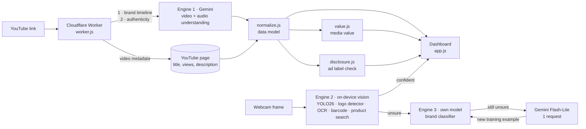

# PlacementRadar

**Paste a YouTube link – PlacementRadar finds every brand in the video, estimates what that exposure is worth, checks whether the advertising is labelled, and rates how genuine the recommendation feels.**

Final project for *MMI5190E – The New Frontiers of AI: From Perception to Agentic Intelligence* (Prof. Pin Luarn), M.Sc. Marketing Intelligence, Pforzheim University, winter term 2026/27. Author: Moritz Binder.

> Live version: `https://placementradar.itsmoribind.workers.dev` *(link follows after deployment)*
> The five example videos work instantly without any setup.

---

## 1. Why this project

Influencer marketing is a multi-billion market, but two questions are hard to answer at scale:

1. **For brands:** *How much exposure did my product get in this video – and how much would that have cost as an ad?*
2. **For viewers and regulators:** *Is this an advertisement, and is it labelled as one?* In Germany, commercial content must be clearly recognisable (§ 5a (4) UWG, § 22 MStV). Hidden advertising ("Schleichwerbung") is a recurring issue.

PlacementRadar answers both from a single YouTube link and adds a third, newer question: *does the recommendation feel genuine?*

## 2. What it does

| Feature | What you see | Status |
|---|---|---|
| **Brand timeline** | one lane per brand: visible / mentioned in speech / on-screen text, click to jump in the video | done |
| **Pause & Find** | pause the video → a panel lists the products in that frame, with the creator's link (affiliate links marked) or a neutral shopping search; soft markers show roughly where they are | done |
| **Media value** | visibility score 0–100 and estimated € value per brand; transparent formula, adjustable CPM and view-through | done |
| **Ad disclosure check** | traffic light: *Disclosure found / Check disclosure / No disclosure found / No advertising detected*, with every place that was checked | done |
| **Authenticity score** | six sub-scores (use shown, balance, specificity, delivery, body language, sales pressure), each with timestamped evidence | done |
| **Live scanner** | webcam or photo: a packaging finder (YOLOE) boxes products on the device, **text recognition reads the brand** (3 of 4 products, no API), a **barcode gives the exact product** via Open Food Facts (name, photo, Nutri-Score), tap a box to ask Gemini; the side panel shows live what each stage sees | v2 done |
| **Own model** | brand classifier trained by us on open product images, learns from Gemini's answers | in progress |
| **Brand report** | one A4 page per brand (value, exposure strip, key moments with YouTube links, disclosure, authenticity, method) – "Save as PDF" via the print dialog – plus a pitch mail to the creator filled with the measured numbers (no extra API call) | done |
| **Waiting screen** | while Gemini watches (2–5 min): video details, a text-only disclosure check of title and description, which model is working and when Google is busy; the page may be closed – the result is stored and loads instantly later | done |

## 3. Architecture – three engines that work together



**Engine 1 – Gemini (cloud).** Understands the whole video, image *and* audio, directly from the YouTube URL (no download). Two calls per video: (1) brand timeline incl. disclosures and rough positions, (2) authenticity of the promoted products. Splitting the calls was necessary: one combined call made smaller models drop most brands (EVALUATION.md, test E).

**Engine 2 – on-device vision (browser).** For the live scanner: a packaging finder (YOLOE – an open-vocabulary YOLO told "snack bag, jar, tub, box …" before export; YOLO26 from unit 3 as fallback), text recognition (OCR) matched against an Open Food Facts brand list, barcode scanning with a lookup in Open Food Facts, and visual product search with an e-commerce embedding model. Costs no API quota and keeps camera images on the device.

**Engine 3 – our own model.** A brand classifier trained on open product images (Open Food Facts) – and continuously on Gemini's answers ("Gemini teaches, the device remembers"). The more the app is used, the less it needs the API.

Every result in the UI shows which engine produced it.

### Why not just Gemini for everything?
The free Gemini tier allows ~20 requests per day per model family (test results in EVALUATION.md). That is plenty for analysing videos (2 requests each, results cached), but far too little for a live camera (1 frame every 2 s would exhaust it in 40 seconds). Hence the on-device engines for live recognition.

## 4. How the numbers are calculated

**Media value** (`public/js/value.js`) – follows sponsorship measurement in sports media: exposure is weighted, not just counted.

```
weighted seconds = Σ visible × size weight × position weight × (in use ? 1.25 : 1)
                 + spoken seconds × 0.5 + on-screen-text seconds × 0.6
value (€)        = views / 1000 × CPM × (weighted seconds / 30) × view-through rate
```
= the price of the same exposure bought as 30-second video ads. CPM (default €15) and view-through (default 50 %) are sliders, because they are assumptions.

**Ad disclosure** (`public/js/disclosure.js`) – looks for labels in title, description, on-screen and speech, and for commercial signals (Gemini's paid/gifted judgement, affiliate or shop links, discount codes). A label in the title, on screen or in the first 30 s counts as *clear*; a label spoken later or buried in the description counts as *weak*. Wording stays neutral – it is a screening aid, not legal advice.

**Authenticity** – Gemini rates six factors 0–100 with timestamped evidence. The score is rounded to steps of 5 because repeated runs vary by about ±6 points (test E). Body language is deliberately only one of six factors: it is a weak cue for honesty (Bond & DePaulo, 2006). Theory: source credibility (Hovland) and the Persuasion Knowledge Model (Friestad & Wright, 1994).

## 5. Data model

One JSON file per analysed video (`public/data/<video-id>.json`):

```jsonc
{
  "video":   { "id", "title", "channel", "views", "duration_s", "upload_date", "description" },
  "brands":  [{ "brand", "product", "category",
                "appearances": [{ "start_s", "end_s", "channel": "visual|audio|text", "size", "position", "in_use", "evidence" }],
                "frames": [{ "t", "box": [ymin, xmin, ymax, xmax] }] }],      // 0–1000, for Pause & Find
  "disclosures":  [{ "time_s", "kind", "text" }],
  "paid":         { "looks_like_paid_promotion", "reasoning" },
  "authenticity": [{ "brand", "product", "overall", "verdict", "sub": { "use_shown": { "score", "time_s", "evidence" }, … } }],
  "source":       { "engine": "gemini", "models": [], "analyzed_at" }
}
```

## 6. Hosting and the Gemini key

The app runs on a Cloudflare Worker. The Gemini key is a Cloudflare **secret** – it never reaches the browser or this repository.

- `KEY_MODE = shared` (until grading): new analyses use the project key. Protected by fixed prompts (no open proxy), daily limits per visitor, a result cache, max. 20-minute videos and an optional invite token.
- `KEY_MODE = own` (afterwards): viewers enter their own free Gemini key; it stays in their browser and goes directly to Google.

The key runs on Google's free tier without billing, so the worst case is an exhausted daily quota – never a bill.

### Staying within free quotas
Everything runs on free tiers; there is no paid fallback. The Worker therefore never pays twice and spreads the load:

| Layer | What happens | API calls |
|---|---|---|
| Example videos | served from `public/data/` in this repository | 0 |
| Every new analysis | stored permanently in Workers KV – the second visitor gets it instantly; `GET /api/recent` lists them | 2 the first time, then 0 |
| Identical camera crops | cached by SHA-256 hash for 30 days | 0 |
| Gemini model chain | each model family has its own free daily quota; a model that reports "per day" quota exhausted is skipped until the reset | – |
| Single-frame provider router | Gemini Flash-Lite → **Cloudflare Workers AI** (Llama 3.2 Vision, free daily allowance, no key) → OpenRouter free models (optional) | 1 per crop |
| Quota empty | the visitor sees *"Today's free analyses are used up – try an example, the live scanner, or come back tomorrow."* `GET /api/config` reports `video_quota_left` beforehand | 0 |

YouTube shows a bot check to data-centre IPs, so the Worker reads views, date and description from the rendered page data; the exact video length needs the optional secret `YOUTUBE_API_KEY` (YouTube Data API v3, free 10,000 units/day), otherwise it is estimated from the brand timeline.

Model names are Worker variables (`VIDEO_MODELS`, `FRAME_MODELS`, `FRAME_PROVIDERS`, …, see `wrangler.jsonc`). When Google retires a model, the variable is changed in the dashboard – no rebuild; a model that returns 404 is skipped automatically.

## 7. Run it

```bash
# examples only (static)
python3 -m http.server 8540 -d public

# full version incl. new analyses (needs a Gemini key in .dev.vars: GEMINI_API_KEY=...)
npx wrangler dev
```

## 8. Repository

```
worker.js                  Cloudflare Worker: API (config, meta, recent, analyze, identify), key modes, limits,
                           KV cache, quota tracking, single-frame provider router
wrangler.jsonc             Worker configuration (no secrets)
public/index.html          app shell
public/css/app.css         design system (light/dark, Apple-like)
public/js/app.js           views: start, overview, timeline, media value, disclosure, authenticity
public/js/player.js        YouTube IFrame API wrapper (muted)
public/js/value.js         media value model
public/js/disclosure.js    ad label check
public/js/shared/          prompts + data normalisation, used by Worker AND browser
public/data/               pre-analysed example videos
tools/                     scripts to prepare demo data
MODELS.md                  every model: source, licence, role, measured performance
EVALUATION.md              all feasibility tests, incl. what did not work
```

## 9. Limitations and ethics

- Gemini can miss brands or misplace them; repeated runs differ (22 vs. 27 brands for the same video). Timestamps were accurate to ±2 s in our checks; positions in the frame are rough.
- Media value depends on assumed CPM and view-through; it is an estimate for comparison, not an invoice.
- The disclosure check and authenticity score judge *content*, not people. Wording is deliberately neutral.
- No video is downloaded or re-hosted. The original YouTube player is embedded (privacy-enhanced mode).
- Live scanner: camera images are processed on the device; only uncertain crops are sent to Gemini.

## 10. Credits

Gemini API (Google) · YouTube IFrame Player API · Open Food Facts (ODbL) · Marqo-Ecommerce embeddings (Apache-2.0) · Ultralytics YOLO26 · Open Food Facts universal-logo-detector (AGPL-3.0) · literature as cited above.
